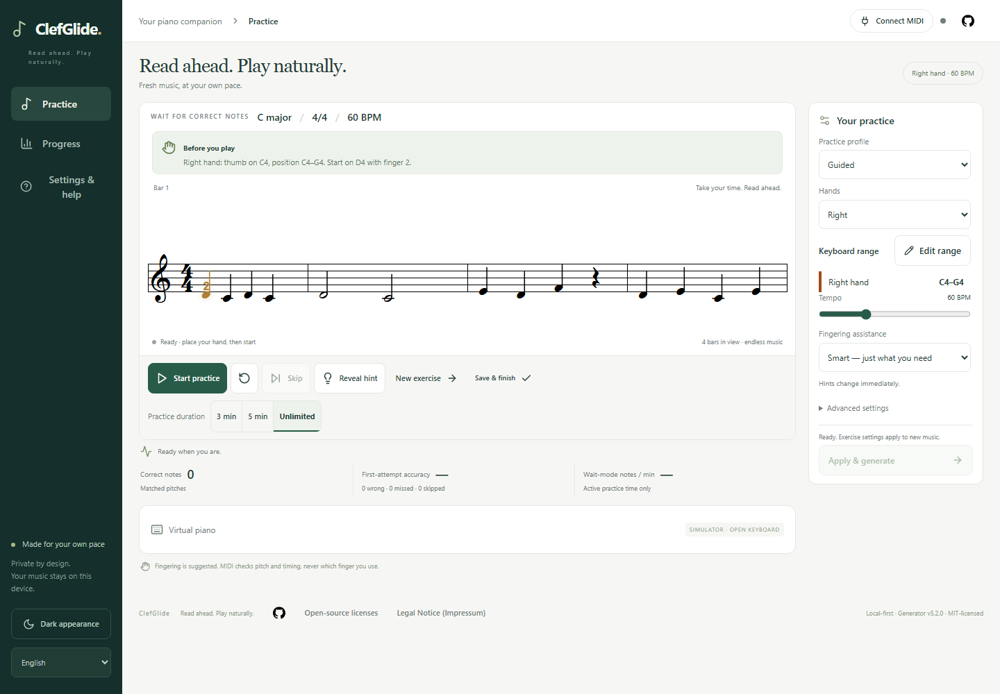

# ClefGlide

ClefGlide is a piano sight-reading trainer for the browser and Android that generates new sheet music as you play. Both platforms share the same React application, exercise generator, notation and scoring. It runs without an account or application server and keeps your practice history on your device.

[Try ClefGlide](https://clefglide.org/)



## Features

- Guided fixed-position and Advanced custom profiles for seeded exercises with either hand or both hands. Advanced parameters include wide leaps, sustained notes, ties, independent voices, dynamic fingering and articulation.
- Treble, bass and grand-staff notation with Smart Hints for finger placement and planned hand movements.
- Wait, timed and benchmark scoring with either practice profile. Timed scoring includes a count-in and separate timing feedback.
- Web MIDI in supported browsers, native USB and BLE-MIDI on Android, and a virtual piano for touch or computer keyboard practice.
- Local progress comparisons by exact configuration and assistance, with JSON backup import/export and CSV summaries.
- Responsive practice controls, light and dark themes, and English and German UI options.

Feature ideas and enhancement requests are welcome through [GitHub issues](https://github.com/0Flush0/clefglide/issues).

Fingering suggestions follow the generator’s rules. MIDI input provides pitch and timing data, and physical playability still needs hands-on review. Adaptive scheduling, MusicXML support and hand-size calibration are future scope.

## Privacy

ClefGlide stores practice progress locally in IndexedDB. Android uses the same storage schema inside its WebView, separately from the website's browser data. Clearing site/app data or uninstalling the Android app removes that local history. Android automatic backups are disabled; use JSON export/import to transfer or back up progress.

JSON backups include session dates and durations, exercise settings and seeds, hint use, and individual note outcomes with pitch and timing data where available. CSV exports contain per-session summaries.

## Local development

Use **Node.js 24** and its bundled npm.

```sh
npm ci
npm run dev
```

Open the URL printed by Vite. Choose an exercise, select **Start practice**, then open **Virtual piano** to play without hardware. For a MIDI keyboard, use Chrome on HTTPS or localhost and select **Connect MIDI**. The [practice guide](docs/PRACTICE.md) covers device setup, hints and progress backups.

## Android

Capacitor packages the existing Vite `dist/` build into an Android APK. The app runs locally and does not load the hosted website. Use **Node.js 24**, **JDK 21**, and Android Studio with **Android SDK Platform 36**. The app supports Android 7.0/API 24 or newer and targets API 36; full edge-to-edge layout requires Android System WebView 140 or newer, with a safe native-inset fallback on older WebViews.

After installing dependencies with `npm ci`:

```sh
npm run android:sync
npm run android:open
```

Enable **USB debugging** on your phone, connect it to the PC, and accept its debugging prompt. In Android Studio, select the **app** configuration and your **physical phone**, then press **Run**. Try the virtual piano first. After installation, disconnect the PC and connect a class-compliant USB MIDI keyboard through a USB/OTG adapter. The app discovers USB inputs automatically. For Bluetooth, select **Discover Bluetooth MIDI** and choose the keyboard's input.

Run `npm run android:sync` after web changes to rebuild and copy the assets before running from Android Studio. The debug APK is produced at `android/app/build/outputs/apk/debug/app-debug.apk`. The [Android guide](docs/ANDROID.md) covers Windows command-line builds, file-picker backups, lifecycle behavior, safe-area layout and the physical-device checklist.

The native adapter handles note-on/off, sustain and USB or Bluetooth disconnections through Android's `MidiManager`. Backgrounding or disconnecting pauses practice. Reconnect and start manually. Android keeps the system bars visible and isolates main-content scrolling from navigation.

**Verification:** Android builds and automated browser/native simulations pass. USB MIDI, native WebView behavior, overscroll, system bars and Android file pickers still require verification on a physical phone and keyboard.

## Checks

```sh
npm run typecheck
npm run lint
npm run test
npx playwright install chromium
npm run test:e2e
npm run build
npm run licenses
npm run test:licenses
```

Vitest covers generator invariants, scoring, notation, MIDI adapter behavior and storage. Playwright exercises the app with simulated input at desktop and tablet viewport sizes. The [QA checklist](docs/QA_CHECKLIST.md) records test evidence and tracks physical MIDI and device checks.

With `JAVA_HOME` set to JDK 21 and `ANDROID_HOME` set to the Android SDK, run the native checks from PowerShell after `npm run android:sync`:

```powershell
.\android\gradlew.bat -p android :app:assembleDebug :app:testDebugUnitTest :app:lintDebug
```

Kotlin JVM tests simulate MIDI decoding, discovery and lifecycle cleanup. Browser tests simulate safe-area changes and verify scrolling and navigation at phone/tablet sizes. These checks do not establish physical USB MIDI compatibility or native Android rendering behavior.

## Architecture

The static app uses React, TypeScript and Vite, with VexFlow for SVG notation, Tonal for music theory, WEBMIDI.js for MIDI, Dexie and Zod for local storage, and Recharts for progress charts.

- [`src/generation`](src/generation) builds seeded phrases from explicit hand states. An independent validator checks each phrase before use.
- [`src/score`](src/score) defines the tick-based score model, derives fingering cues and renders the sheet music.
- [`src/midi`](src/midi) routes hardware and virtual input into the same [scoring engine](src/scoring). A small adapter factory selects WEBMIDI.js for browsers and the local Kotlin MIDI plugin for Android, preserving the `MidiBus`/`MidiEvent` contract.
- [`src/practice`](src/practice) coordinates exercises, playback and the UI. [`src/progress`](src/progress) handles local sessions and backups.
- [`src/platform`](src/platform) isolates Android layout, system-bar appearance and file exports while preserving browser behavior. [`android`](android) contains the native project, local plugins, Gradle wrapper and JVM tests; [`capacitor.config.ts`](capacitor.config.ts) points to the shared production build.

See the [product requirements](docs/REQUIREMENTS.md), [implementation decisions](docs/DECISIONS.md), [development notes](docs/DEVELOPMENT.md) and [hosting guide](docs/HOSTING.md).

## AI-assisted development

AI Agents assisting with implementation, tests and documentation. The trainer generates exercises with deterministic rules and validates each phrase locally.

## Licensing

ClefGlide’s own code is available under the [MIT License](LICENSE), which permits commercial use. Third-party libraries and bundled fonts retain their own licenses. Their notices are available from **Open-source licenses** in the app footer and in the production build. See the [notice generation notes](docs/DEVELOPMENT.md#third-party-notices).
