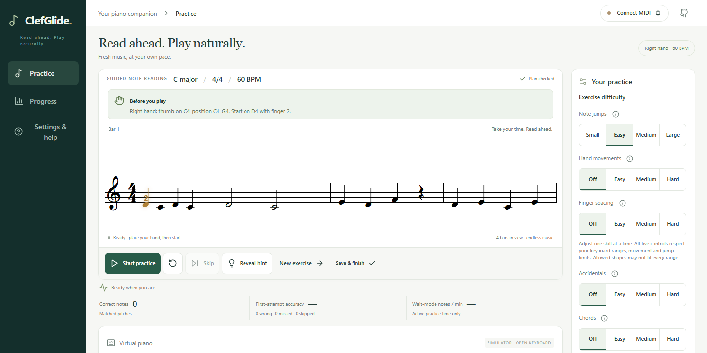

# ClefGlide

ClefGlide is a browser-based piano sight-reading trainer that generates new sheet music as you play. It runs without an account or application server and keeps your practice history in your browser.

[Try the live demo](https://piano.rit.cl/)



## Features

- Seeded exercises for either hand or both hands, with adjustable note ranges, leaps, hand movements, finger spacing, accidentals and chords.
- Treble, bass and grand-staff notation with Smart Hints for finger placement and planned hand movements.
- Guided practice that waits for the correct notes, plus timed practice with a count-in and separate timing feedback.
- Web MIDI input and a virtual piano for touch or computer keyboard practice.
- Local progress comparisons by difficulty and assistance, with JSON backup import/export and CSV summaries.
- Responsive practice controls, light and dark themes, and English and German UI options.

Fingering suggestions follow the generator’s rules. MIDI input provides pitch and timing data, and physical playability still needs hands-on review. Adaptive scheduling, MusicXML support and hand-size calibration are future scope.

## Local development

Use **Node.js 24** and its bundled npm.

```sh
npm ci
npm run dev
```

Open the URL printed by Vite. Choose an exercise, select **Start practice**, then open **Virtual piano** to play without hardware. For a MIDI keyboard, use Chrome on HTTPS or localhost and select **Connect MIDI**. The [practice guide](docs/PRACTICE.md) covers device setup, hints and progress backups.

## Checks

```sh
npm run typecheck
npm run lint
npm run test
npx playwright install chromium
npm run test:e2e
npm run build
npm run licenses
npm run test:licenses
```

Vitest covers generator invariants, scoring, notation, MIDI adapter behavior and storage. Playwright exercises the app with simulated input at desktop and tablet viewport sizes. The [QA checklist](docs/QA_CHECKLIST.md) records test evidence and tracks physical MIDI and device checks.

## Architecture

The static app uses React, TypeScript and Vite, with VexFlow for SVG notation, Tonal for music theory, WEBMIDI.js for MIDI, Dexie and Zod for local storage, and Recharts for progress charts.

- [`src/generation`](src/generation) builds seeded phrases from explicit hand states. An independent validator checks each phrase before use.
- [`src/score`](src/score) defines the tick-based score model, derives fingering cues and renders the sheet music.
- [`src/midi`](src/midi) routes hardware and virtual input into the same [scoring engine](src/scoring).
- [`src/practice`](src/practice) coordinates exercises, playback and the UI. [`src/progress`](src/progress) handles local sessions and backups.

See the [product requirements](docs/REQUIREMENTS.md), [implementation decisions](docs/DECISIONS.md), [development notes](docs/DEVELOPMENT.md) and [hosting guide](docs/HOSTING.md).

## AI-assisted development

OpenAI Codex assists with implementation, tests and documentation. The trainer generates exercises with deterministic rules and validates each phrase locally.

## Licensing

ClefGlide’s own code is available under the [MIT License](LICENSE), which permits commercial use. Third-party libraries and bundled fonts retain their own licenses. Their notices are available from **Open-source licenses** in the app footer and in the production build. See the [notice generation notes](docs/DEVELOPMENT.md#third-party-notices).
