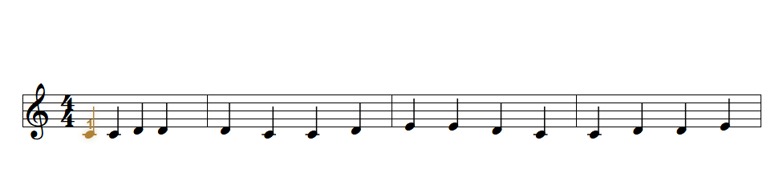
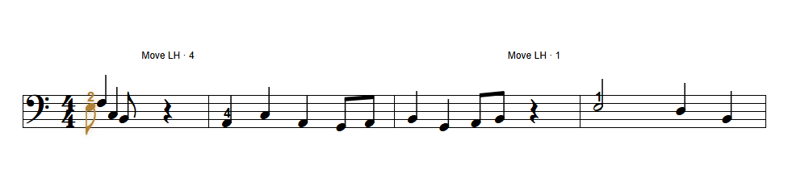
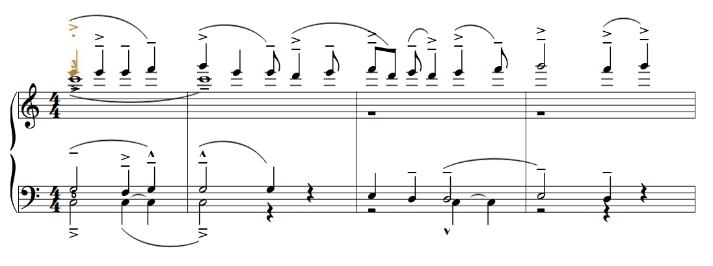
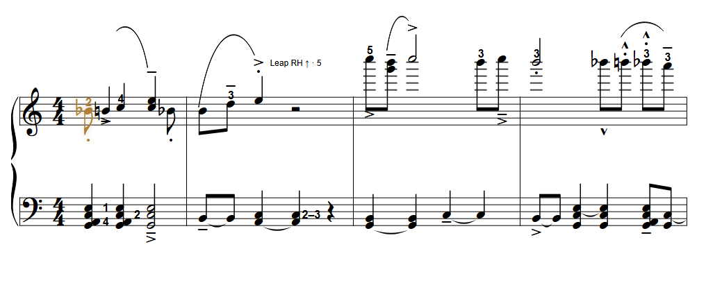

# Guided curriculum v2

ClefGlide has 90 left-hand levels, 90 right-hand levels and 89 two-hand levels across ten stages per track. Every level has a stable hand-prefixed ID, a version, a specific reading task, a default tempo, a suggested range and a complete exercise recipe. Single-hand lessons share a teaching sequence with different clefs, registers, key choices and voicing bands. The duet curriculum develops coordination and alternates which hand reads the denser line.

[Complete per-level catalog and measured results](GUIDED_CURRICULUM.csv) · [Single-hand recipes](../src/practice/curriculumSingle.ts) · [Duet recipes](../src/practice/curriculumDuet.ts)

## Choosing a level

Use the arrows beside the stage name to move between stages, or jump directly through **Browse stages and levels**. Returning to a stage restores its last selected level for that hand track. A stage you have yet to visit opens at its first level. Use the numbered buttons or the level selector to choose within that stage. The summary shows the stage position, global level number, keyboard range and tempo. Choose any level at any time.

Selecting a different level stages its full recipe, including range, notation, rhythm, technique and default tempo. Apply or start a new exercise to generate it. The tempo slider, note-name range picker and available notation controls are explicit overrides. **Restore level settings** returns to the recipe while retaining scoring mode and assistance preferences. Independent levels keep their prescribed meter. The last selection and overrides are saved for each hand track.

Known v1 selections map to the corresponding v2 topics, such as Wider intervals or Treble over tied bass. The existing applied exercise and its settings remain available until a new exercise is generated. Pre-curriculum saved setups remain selectable as saved setups until the first level choice. Older history retains its original configuration, seed and fingerprint. A v1 practice record never marks a v2 level practised or completed. For v2, a recorded correct note marks a level practised. A finished session with recorded results marks it completed. Completion does not unlock or advance levels.

## Left and right hand

The opening range is C3–G3 for left hand and C4–G4 for right hand. The recipe fixes a five-finger map within each starting exercise in the first two stages. The position may change between exercises as learners move to neighboring registers. Mobile levels commit their new position at each written landing and carry it across the next chunk boundary.

| Levels | Stage | Reading objective and progression | Register and default BPM |
| --- | --- | --- | --- |
| 1–9 | Foundations | Repeats and steps on quarters, then changes of direction, halves, a one-beat rest and thirds. | One five-finger register at a time, 48–62 |
| 10–18 | Rhythmic fluency | Fourths, sparse to more frequent eighths, 3/4, changed key signatures, whole notes and longer rests. | Nearby five-finger registers, 56–66 |
| 19–27 | Hand mobility | Explicit one- through four-step relocation with increasing landing opportunities. Coverage targets and approved spaced shapes follow. | LH expands toward C2–G3 and RH toward C4–G5, 56–68 |
| 28–36 | Harmony | Embedded thirds, open dyads, voiced cadences, triads and changes between chord shapes and melody. | The mobile bands keep nearby harmonic shapes available, 60–70 |
| 37–45 | Sustained playing | Release targets, subdivisions, tied eighths, barline connections, whole-chord and partial holds, and phrase carry. | Retains the current register while the hold rules change, 60–66 |
| 46–54 | Keyboard fluency | Independent preparation for wide leaps, more landing windows, chromatic resolutions and new key signatures. | LH C1–C4 and RH G3–G6, 60–70 |
| 55–63 | Fingering fluency | Isolate an adjacent reach, continuous shift, thumb-under, finger-over, rested alternate and substitution. Then combine techniques under varied rhythms. | The same wide register with slower introduction of contact changes, 60–70 |
| 64–72 | Polyphony | Add a second finger-partitioned voice, then independent releases, tied layers and whole-note carry across multiple boundaries. | Wide starting range with a stable position per exercise during sustained layers, 62–74 |
| 73–81 | Expression | Interpret staccato, tenuto, accents, legato and portato slurs, cross-phrase grouping and timed expression. | Two independently sustained lines, 66–74 |
| 82–90 | Mastery | Alternate broad chromatic travel, extended chord reading, layered carry and a faster concert study. | Travel uses the full wide bands. Stationary extension studies focus on LH C2–G3 and RH E4–E5 for feasible four-note grips. Defaults 74–92. |

## Both hands

The bass and treble start in separate C3–G3 and C4–G4 positions. Later lessons split ranges, rhythmic vocabularies, intervals, movement policies and expression. Bass may anchor a moving treble, then become the mobile or more rhythmically active part.

| Levels | Stage | Reading objective and progression | Register and default BPM |
| --- | --- | --- | --- |
| 1–9 | Together | Simultaneous steps and releases, differing contours, shared rests, thirds and 3/4. | Neighboring five-finger positions on the grand staff, 44–58 |
| 10–18 | Coordination | Alternate quarters over halves. Change which hand leads, introduce separate rests and increase melodic asymmetry. | Comfortable central registers, 48–60 |
| 19–27 | Rhythmic independence | Add eighths in one hand at a time, hand-local breaths, 3/4, full-bar bass holds and less predictable offbeats. | Separate central registers, 54–66 |
| 28–36 | Paired mobility | Learn one hand's prepared shift while the other sounds. Alternate the landing windows and allow spaced positions. | Bass grows to C2–G3 and treble to C4–A5, 56–68 |
| 37–45 | Harmony and accompaniment | Add thirds, wider dyads and triads, then trade the voiced line while retaining different attack rhythms. | Mobile bands with close and contrasting harmonic shapes, 60–70 |
| 46–54 | Sustained parts | Separate bass and treble release, full and partial chord ties, phrase carry and overlapping obligations. | Steadier positions give carried notes room, 62–72 |
| 55–63 | Keyboard dialogue | Prepare progressively wider leaps on each side, trade windows and read chromatic resolutions in both parts. | Bounds expand toward LH C1–A3 and RH C4–E7, 66–76 |
| 64–72 | Independent fingering and voices | Isolate crossings over the partner, then transfers and two, three and four concurrent written voices. | Wide register selection with prepared, locally isolated contact changes, 66–74 |
| 73–81 | Expressive dialogue | A different articulation or slur pattern on each staff, including slurs across boundaries and timed feedback. | Wide starting bands with stable voicing, 70–78 |
| 82–89 | Mastery | Alternate traveling treble, traveling bass, extended chords, partial ties and independently articulated layers. | Broad separated ranges. The concert duet uses LH C1–A3 and RH C4–E7, 76–92. |

Suggested tempos extend 8 BPM on either side of the default, with a lower floor of 38 BPM. The catalog lists the exact recommendations. Returning to a slower pulse for a new motor or reading skill is deliberate.

## What the calibration measured

The [audit](../src/practice/curriculum.test.ts) generated 8,328 phrases with zero search exhaustions and zero validation failures. Each level used four reproducible seeds and six consecutive phrases per seed. Each mastery level used eight seeds and twelve consecutive phrases per seed. The independent validator checked every phrase and continuation. Mastery samples also passed through timed scorer construction and appending.

The [catalog](GUIDED_CURRICULUM.csv) lists observed spans, pitch counts, interval histograms, attack durations and offbeats, rests, intended simultaneous keys, chord attacks, motion distances, notation marks and phrase incidence for the targeted capabilities. Intervals use successive attacks within a voice, and onset density counts distinct onset groups at the default tempo. Partial ties count an attack with a fresh tone and a continuing tone. A long carry remains held into a second following chunk. The pitch ranges are unions across sampled seeds and chunks. A stationary exercise uses a single playable position within its configured register.

The test checks that every declared focus occurs in at least two sampled phrases, or eight at mastery. It also checks for duplicate recipe-and-tempo pairs and caps the sampled increase in onset groups per minute at 35% between neighboring lessons. The largest observed increases were 31.4% left, 28.0% right and 30.6% both. This guard measures reading density. Chord size, voice independence, travel and expression have separate columns and can rise as attack density falls.

| Mastery study | Selected observations from 96 phrases |
| --- | --- |
| Left concert study | 36 distinct pitches from C1 to C4. Wide moves in 75 phrases, both crossing types represented, substitutions in 40 and slurs in 96. |
| Right concert study | 36 distinct pitches from G3 to G6. Wide moves in 77 phrases, triads in 20 and substitutions in 43. |
| Right four-note voicings | Four-tone attacks in 58 phrases, triads in 69, partial chord ties in 91 and substitutions in 34. |
| Both extended harmony under two voices | Four-tone attacks in 20 phrases, partial holds in 86, multi-phrase holds in 23 and same-hand simultaneous independent voices in 96. The longest modeled hold was 28 beats. |
| Both concert duet | Treble across 40 distinct pitches from C4 to E7. Wide moves in 77 phrases, thumb-under in 61, finger-over in 58, four-tone attacks in 46, partial holds in 87, carry in 55 and slurs in 96. |

To regenerate the full report with Node 24:

```powershell
New-Item -ItemType Directory -Force .tools/guided-v2 | Out-Null
$env:GUIDED_REPORT = "$PWD/.tools/guided-v2"
npx vitest run src/practice/curriculum.test.ts --configLoader native --pool threads --maxWorkers 1
node scripts/guided-curriculum-report.mjs .tools/guided-v2 docs/GUIDED_CURRICULUM.csv
```

## Representative notation

These are seeded excerpts engraved by the production score renderer. Select the level and enter the named seed under **Advanced settings** to regenerate the excerpt. The [browser test](../e2e/guided-examples.spec.ts) verifies the example selection and rendering.

**Beginner · Right 1 · Find the notes · 48 BPM · `guided-example-0`**



**Intermediate · Left 22 · Explore nearby positions · 62 BPM · `guided-example-0`**



**Advanced · Both 81 · Phrase four voices · 78 BPM · `guided-example-0`**



**Mastery · Both 89 · Read a concert duet · 92 BPM · `guided-example-2`**



## Model limits and physical review

The existing model supports major keys C, G, F and D, 3/4 and 4/4, and written eighths through whole notes. Other keys, tuplets, dotted rhythms, sixteenths, pedaled phrase generation, and general repertoire textures would need generator and engraving work. The curriculum uses short procedural forms and the supported voicing library.

The limits on hand crossing, chord reach, allowable black-key contacts, transfer clearance and prepared movement are intentional ergonomic constraints. A held tone can occupy a finger and prevent that hand from moving. Continuous crossings need an isolated source and landing. These constraints explain why several mastery lessons put different challenges in different hands or alternate mobile and sustained studies. Four-note voicings use defined sixth and seventh extensions and are sensitive to the initial map and harmony. Range coverage chooses eligible destinations and can leave some pitches unused within any given session.

The entire curriculum is provisional pending review on physical pianos. Priorities are novice tempo and range choices, stage-to-stage reading load, the first independently released bass line, large-leap cue timing, thumb and finger transfers, small-hand chord spacing, the demands of keeping one key down across phrases, and notation legibility in high registers and four-voice studies. USB/BLE MIDI, pedal behavior and repeated-key recovery need separate hardware verification. The automated evidence covers modeled contacts, engraved notation and simulator behavior. Physical comfort and actual fingering require observation of the pianist.
